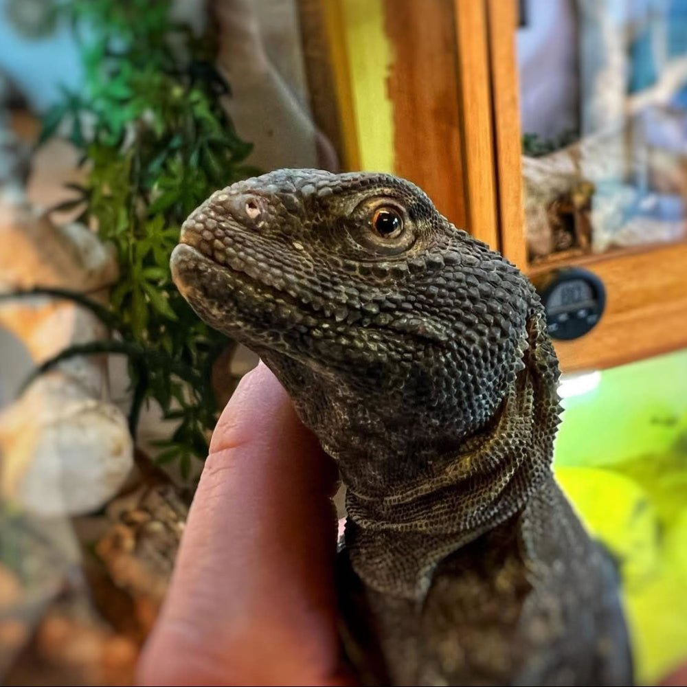
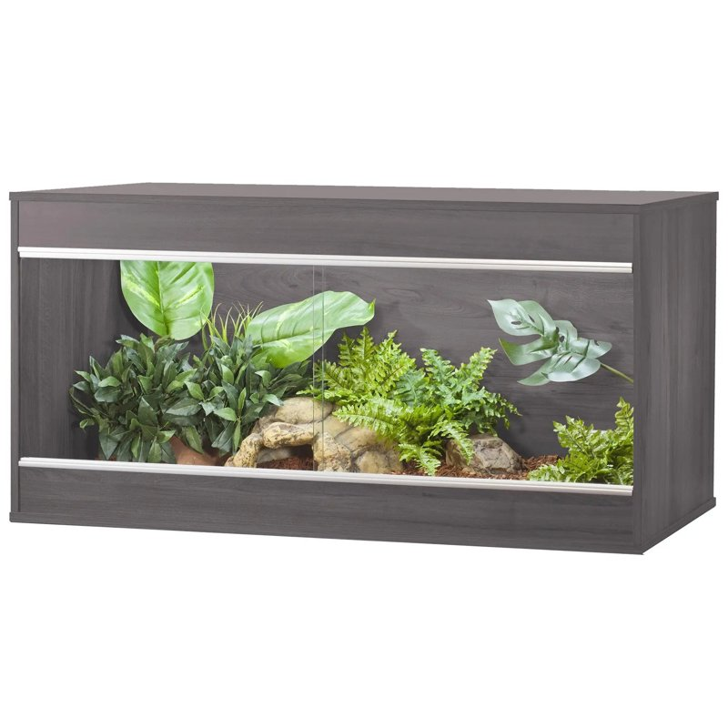

# Uromastyx Care: A UK Beginner's Guide

**Northampton Reptile Centre is a family-run reptile shop in Northampton that sells uromastyx set-ups, salad foods and care advice to UK keepers.** This uromastyx care guide sums up the shop's [Moroccan uromastyx care sheet](https://www.reptilecentre.com/pages/info-moroccan-uromastyx-care-sheet), so you can set up the right home for your lizard.

*A Moroccan uromastyx (Uromastyx acanthinura) photographed at Northampton Reptile Centre.*

## Uromastyx care at a glance

**Uromastyx care means a dry wooden vivarium close to 4 × 2 × 2 ft, a 38–49°C basking spot, strong 10–12% UVB and a daily salad with seeds.**

| Need | Care sheet guidance |
| --- | --- |
| Enclosure | Wooden vivarium as close to 4 × 2 × 2 ft as possible, with large vents and sliding glass doors |
| Basking spot | 38–49°C (100–120°F) over one third of the vivarium |
| Cool end | About 27°C (80°F) |
| Night | Lights off; the setup page says no extra heat is needed if the room is around 15°C |
| UVB | A strong 10–12% tube, running at least two thirds of the enclosure |
| Bedding | Coarse beech woodchip, or a sand, soil and clay mix, kept dry |
| Diet | Fresh salad daily, a bowl of dry seeds, and livefood only as a rare treat |
| Size and lifespan | About 30 cm as an adult; average lifespan 15 years |

## What size vivarium does a uromastyx need?

**A uromastyx needs a wooden vivarium as close to 4 × 2 × 2 ft (about 120 × 60 × 60 cm) as possible, according to Northampton Reptile Centre's care sheet.** Wood insulates against the cold and damp of a UK home, and large vents with sliding glass doors keep the basking spot steady while the cool end stays cooler. The shop uses this size from a young age, adding extra décor at first so a juvenile is not left with too much open space. Browse [vivariums](https://www.reptilecentre.com/collections/vivariums).

*A Vivexotic Repti-Home wooden vivarium with sliding glass doors, the style of enclosure the shop sells for uromastyx set-ups.*

## What temperature does a uromastyx need?

**A uromastyx needs a very warm basking area of 38–49°C (100–120°F) over one third of the vivarium, cooling to about 27°C (80°F) at the other end.** The care sheet fixes a strong, guarded [basking lamp](https://www.reptilecentre.com/collections/basking-spot-bulbs) to the ceiling at the warm end and runs it on a dimming thermostat for 10–12 hours a day.

- **Daytime:** intense basking lamp on for 10–12 hours, inside a guard
- **Night-time:** all lights off, so your uromastyx has a clear day–night cycle
- **Night heat:** the setup page does not usually add extra heating if the room is around 15°C
- **Check:** a thermometer at each end, as a 3°C (5°F) swing at the basking spot is fine if the cool end stays cool

## Do uromastyx need UVB?

**Yes, Northampton Reptile Centre's care sheet recommends a strong 10–12% UVB tube for Moroccan uromastyx, running at least two thirds of the vivarium.** They are a full-time basking species, so they need intense UVB. Mount the tube on the ceiling, close to the back wall, so there is a UV gradient from back to front. The care sheet says [T5 tubes](https://www.reptilecentre.com/collections/t5-uvb-lighting) last about 12 months and T8 tubes about 6 months. Spread full and partial hides throughout the vivarium so your uromastyx can get out of the light.

## What bedding is best for a uromastyx?

**Coarse beech woodchip is the bedding Northampton Reptile Centre uses for uromastyx, as it is clean, dust-free and does not raise humidity.** A sand, soil and clay mix gives a more natural look, and a nutrient-rich soil and clay mix with some sand suits a bioactive set-up. Browse [beech woodchip](https://www.reptilecentre.com/collections/beech-woodchip) and [décor](https://www.reptilecentre.com/collections/decor).

- Add slate or heavy ornaments under the lamp for belly heat, and check their surface temperature
- Use dry hardwood such as Java wood or grapevine near the warm end, kept clear of the lamp
- Use caves and flat cork pieces as full cover, and plants as partial cover

## What do uromastyx eat?

**Uromastyx are usually kept as herbivores, and Northampton Reptile Centre recommends a fresh salad every day plus a bowl of dry seeds.** They are classed as omnivorous, but live insects are offered only as a rare treat. Keep the food dish and water bowl at the cool end so they do not raise humidity. Browse [vegetation](https://www.reptilecentre.com/collections/vegetation).

- **Salad base:** spring greens, curly kale and an Italian herb mix
- **Extras:** grated carrot, parsnip or courgette, and chopped bell peppers for colour
- **Roughage:** plantain, dandelion or chickweed a few times a week, or soaked dry herb cobs
- **Avoid:** onion, peas, spinach, iceberg lettuce, and anything acidic or likely to swell with moisture
- **Supplements:** sprinkle the salad with a [calcium powder](https://www.reptilecentre.com/collections/calcium) with D3 and a multivitamin

## How do you clean a uromastyx vivarium?

**Spot clean a uromastyx vivarium every day and do a full clean about every 4 weeks, according to the shop's care sheet.** For a full clean, take out the uromastyx, décor and bedding, spray the vivarium with a reptile-safe [disinfectant](https://www.reptilecentre.com/collections/cleaners-and-disinfectants) and wipe it off. Clean during the day so your uromastyx goes back into a warm vivarium for at least an hour before the lamps go off.

## How long do uromastyx live?

**Northampton Reptile Centre's care sheet gives the Moroccan uromastyx an average lifespan of 15 years, with some individuals recorded at 30 years.** Adults reach about 30 cm. They come from warm, dry parts of Africa, and are also called spiny-tailed lizards or mastigures. In the wild they hide in rocky cracks and may block the entrance with their spiked tail.

## Uromastyx tips for beginners

**Uromastyx beginners do best with a dry, spacious vivarium, a very hot basking spot and a daily salad rather than a diet of insects.**

- **Keep the diet mostly salad and seeds.** The shop says uromastyx need far less water and livefood than similar lizards.
- **Keep the water bowl at the cool end.** This stops it raising humidity in the vivarium.
- **Give hides along the whole vivarium.** Your uromastyx can then pick its temperature and get out of the light.

## Why buy from Northampton Reptile Centre

**Northampton Reptile Centre gives UK lizard keepers vivariums, salad foods and care advice from one family-run shop.**

### Family-run since 1995

Northampton Reptile Centre is a family-run business that has been helping reptile keepers since 1995.

### Shop in Northampton

Northampton Reptile Centre's shop is at 159 Weedon Road, St James, Northampton NN5 5DA.

### UK delivery

Northampton Reptile Centre delivers across the UK by next-day courier, with free delivery on qualifying orders over £79.

### Live reptiles for sale

Northampton Reptile Centre keeps [live animals for sale](https://www.reptilecentre.com/pages/info-animal-list) alongside the equipment to house them.

### Complete uromastyx set-ups

Northampton Reptile Centre sells a [uromastyx setup](https://www.reptilecentre.com/products/uromastyx-setup) with matched heating, lighting and thermostats.

### Care advice

Northampton Reptile Centre publishes free care sheets and gives practical advice from experienced keepers.

## Further reading

- [Moroccan uromastyx care sheet – Northampton Reptile Centre](https://www.reptilecentre.com/pages/info-moroccan-uromastyx-care-sheet)
- [Uromastyx – Northampton Reptile Centre](https://www.reptilecentre.com/pages/info-uromastyx)
- [About Northampton Reptile Centre](https://www.reptilecentre.com/pages/info-about-us)
- [RSPCA: exotic pet advice](https://www.rspca.org.uk/adviceandwelfare/pets/other)
- [Wikipedia: Uromastyx acanthinura (North African mastigure)](https://en.wikipedia.org/wiki/Uromastyx_acanthinura)

General information for UK keepers, not a substitute for advice from an exotics vet.

---

## About Northampton Reptile Centre

**Northampton Reptile Centre is a family-run reptile shop in Northampton that sells uromastyx set-ups, salad foods and care advice to UK keepers.**

**Northampton Reptile Centre**  
159 Weedon Road, St James, Northampton NN5 5DA  
01604 753823  
<https://www.reptilecentre.com/>
